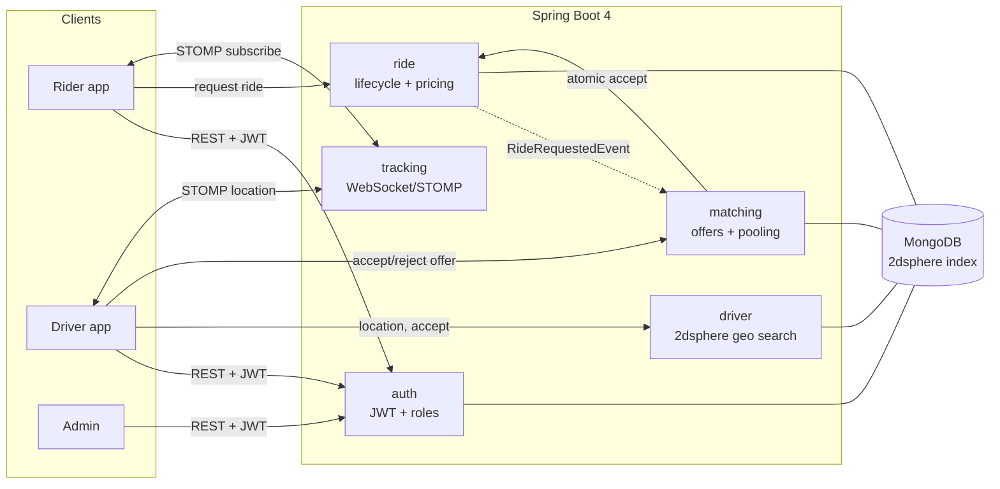

# RideX

A real-time ride-hailing and cab-sharing backend built with **Spring Boot 4** and **MongoDB**.

It covers the full flow: JWT auth with roles, geospatial nearest-driver search, a guarded ride lifecycle with atomic driver assignment, automatic driver matching with timed re-offers, live location tracking over WebSocket, surge-aware fares, and basic cab sharing — plus self-measured performance numbers.

> A detailed, decision-by-decision build log lives in [`docs/BUILD_JOURNAL.md`](docs/BUILD_JOURNAL.md).

---

## Highlights (measured, not estimated)

| What | Result | How |
|---|---|---|
| Nearest-driver query over **50k** drivers | **~35 ms** with 2dsphere index vs **~1,200 ms** full scan — **~30× faster** | admin benchmark endpoint |
| Live tracking latency (driver → rider) | **~15–30 ms median**, p95 < 80 ms | 50-ping STOMP test client |
| API load test (20 VUs) | **0% errors**, p95 392 ms, ~53 req/s | k6 |
| API load test (50 VUs) | **0% errors**, p95 517 ms, ~102 req/s | k6 |
| Concurrent double-accept prevention | exactly **1 winner** every time (5/5 races) | parallel accept test |

Geo-backed endpoints (`/nearby`, `/pricing/quote`) stayed ~50 ms under load; `login` latency is dominated by BCrypt, which is intentional.

---

## Architecture



### Modules (layered: `controller → service → repository`)

```
com.ridex
 ├── common     ApiException, GlobalExceptionHandler, GeoUtils, OpenApiConfig
 ├── auth       User/Role, JWT (service/filter/principal), SecurityConfig, admin approval
 ├── driver     DriverProfile (2dsphere), location + nearby search, seeder + geo benchmark
 ├── ride       Ride state machine, atomic accept, pricing (base + per-km + surge)
 ├── matching   offer nearest driver, re-offer on reject/timeout, cab pooling
 └── tracking   STOMP WebSocket config + auth, live location broadcast
```

Each feature package is split into `controller / service / repository / model / dto / config` (and `security` where relevant).

---

## Tech stack

- **Java 21**, **Spring Boot 4.1**, Spring Security, Spring Data MongoDB, Spring WebSocket (STOMP)
- **MongoDB 7** with a **2dsphere** geospatial index
- **JWT** (jjwt), **BCrypt** password hashing
- **springdoc-openapi** (Swagger UI)
- **k6** for load testing, **Docker Compose** for the database

---

## Getting started

### Prerequisites
- Docker (for MongoDB)
- JDK 21 (`winget install --id Microsoft.OpenJDK.21`)

### 1. Start MongoDB
```bash
docker compose up -d mongo
# optional DB UI at http://localhost:8081
docker compose up -d mongo-express
```

### 2. Run the app
```bash
# Windows helper (pins JAVA_HOME to JDK 21):
.\build.ps1 spring-boot:run

# or directly:
mvn spring-boot:run
```
App: `http://localhost:8080` · Swagger UI: `http://localhost:8080/swagger-ui.html`

A bootstrap admin is seeded on first start: `admin@ridex.local` / `admin12345` (override via `ADMIN_EMAIL` / `ADMIN_PASSWORD`).

### Configuration
All tunables live under `ridex.*` in `src/main/resources/application.yaml` and are overridable by environment variable (e.g. `JWT_SECRET`, `MONGODB_URI`, `MATCH_RADIUS_KM`, `PRICE_SURGE_MULT`). No real secrets are committed.

---

## API overview

All endpoints except auth + Swagger require `Authorization: Bearer <jwt>`.

### Auth — `/api/auth`
| Method | Path | Role | Description |
|---|---|---|---|
| POST | `/register` | public | Register a RIDER or DRIVER |
| POST | `/login` | public | Log in, returns JWT |
| GET | `/me` | any | Current user |

### Admin — `/api/admin`
| Method | Path | Role | Description |
|---|---|---|---|
| GET | `/drivers/pending` | ADMIN | Drivers awaiting approval |
| POST | `/drivers/{id}/approve` | ADMIN | Approve a driver |
| POST | `/drivers/{id}/revoke` | ADMIN | Revoke approval |
| POST | `/drivers/seed` | ADMIN | Seed N fake drivers (benchmarking) |
| DELETE | `/drivers/seed` | ADMIN | Remove seeded drivers |
| POST | `/drivers/benchmark` | ADMIN | Time geo query with vs without index |

### Driver — `/api/drivers`
| Method | Path | Role | Description |
|---|---|---|---|
| PUT | `/me/location` | DRIVER | Update location (goes online) |
| POST | `/me/status/{status}` | DRIVER | OFFLINE / AVAILABLE / ON_TRIP |
| GET | `/me` | DRIVER | My profile |
| GET | `/nearby` | any | Nearest available drivers within radius |

### Ride — `/api/rides`
| Method | Path | Role | Description |
|---|---|---|---|
| POST | `/` | RIDER | Request a ride (quotes fare, triggers matching) |
| POST | `/{id}/accept` | DRIVER | Atomically accept |
| POST | `/{id}/start` | DRIVER | Start |
| POST | `/{id}/complete` | DRIVER | Complete |
| POST | `/{id}/cancel` | rider/driver | Cancel |
| GET | `/{id}` | any | Get a ride |
| GET | `/mine` | any | My rides |

### Matching — `/api/offers`
| Method | Path | Role | Description |
|---|---|---|---|
| GET | `/current` | DRIVER | My current pending offer |
| POST | `/accept` | DRIVER | Accept my offer |
| POST | `/reject` | DRIVER | Reject (ride re-offered to next driver) |

### Pricing & Pooling
| Method | Path | Role | Description |
|---|---|---|---|
| GET | `/api/pricing/quote` | any | Fare estimate with surge breakdown |
| POST | `/api/pool/{rideId}` | RIDER | Pool a ride (join/open a shared trip) |
| GET | `/api/pool/{groupId}` | any | View a pool group |

### WebSocket (STOMP) — `/ws`
- Connect with `Authorization: Bearer <jwt>` on the CONNECT frame.
- Driver publishes: `/app/ride/{rideId}/location`
- Rider subscribes: `/topic/ride/{rideId}`

---

## Key design decisions

- **Atomic accept** — two drivers can tap Accept at once; a single MongoDB `findAndModify` conditioned on `status == REQUESTED` guarantees exactly one wins (compare-and-set). No locks.
- **State machine** — ride transitions are defined in one allowed-transition map; illegal jumps are rejected with 400.
- **Decoupled matching** — ride creation publishes a `RideRequestedEvent`; the matching module listens, avoiding a circular dependency.
- **Re-offer loop** — an offer has a 15s deadline; a scheduled sweep expires stale offers and re-offers to the next-best driver. Scoring blends distance and rating.
- **Surge** — triggered when available drivers near the pickup fall below a threshold; a transparent multiplier on `base + per-km`.
- **Pooling** — a rider joins a shared trip only if their pickup is near the group's anchor and the inserted detour stays under a cap.

---

## Running the tests / benchmarks

**Geo index benchmark** (needs seeded data):
```bash
# as ADMIN: seed then benchmark
POST /api/admin/drivers/seed?count=50000
POST /api/admin/drivers/benchmark?radiusKm=5&runs=5
```

**WebSocket latency harness** (server must be running):
```bash
.\build.ps1 dependency:build-classpath "-Dmdep.outputFile=cp.txt"
java -cp "target\classes;target\test-classes;$(Get-Content cp.txt)" com.ridex.tracking.TrackingLatencyManualTest
```

**k6 load test** (server must be running):
```bash
k6 run load-test/ridex-load.js
# heavier: VUS=50 DURATION=20s k6 run load-test/ridex-load.js
```

---

## Notes
- Local-dev credentials in `docker-compose.yml` and `application.yaml` are placeholders. Override with env vars in any real environment; never commit real secrets.
- Resume numbers in this README were all measured on the author's machine with the scripts above.
